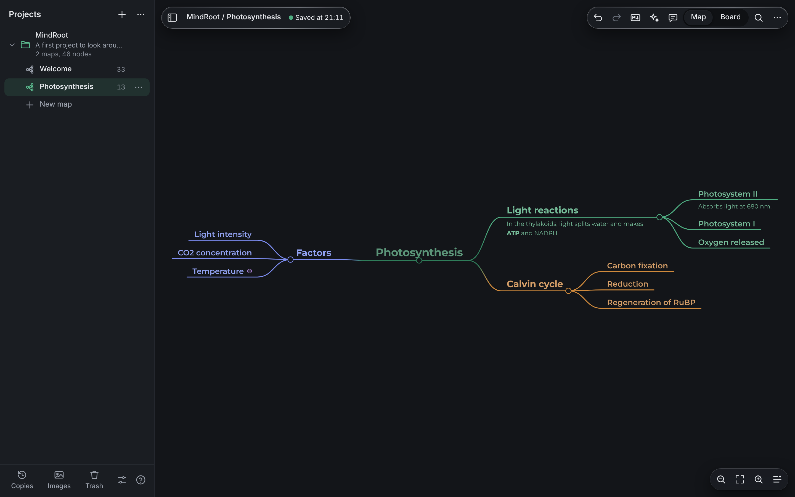
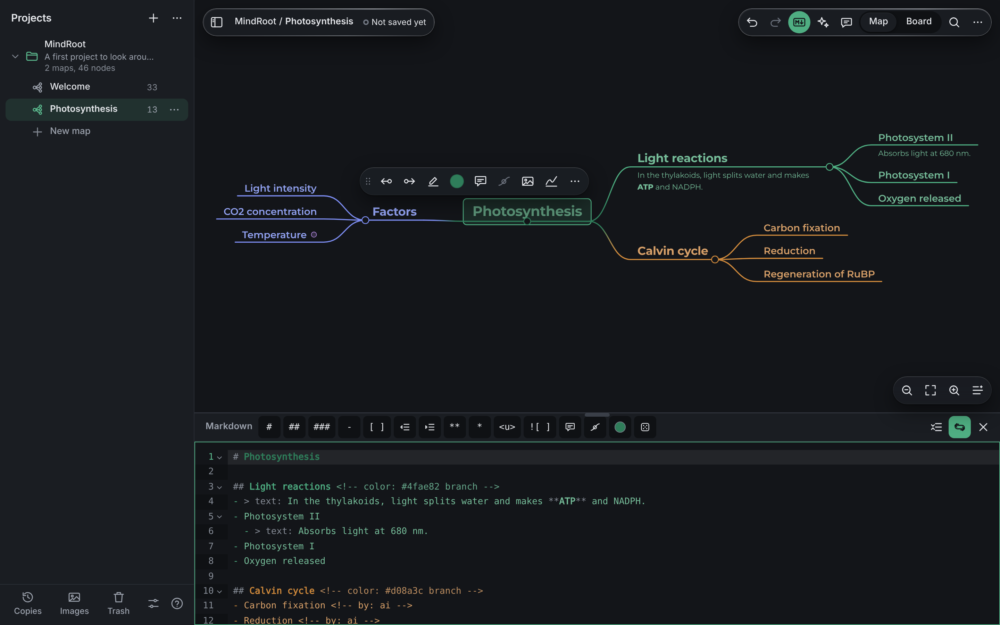
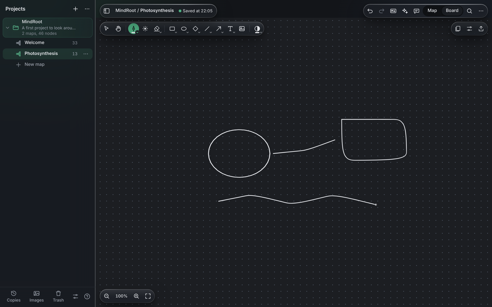
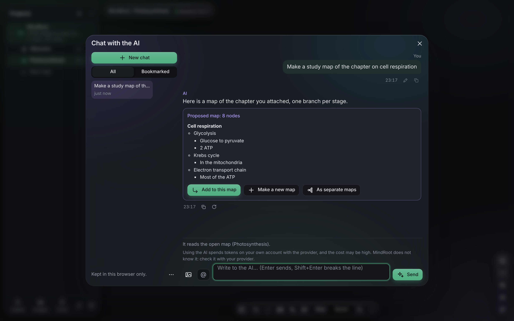
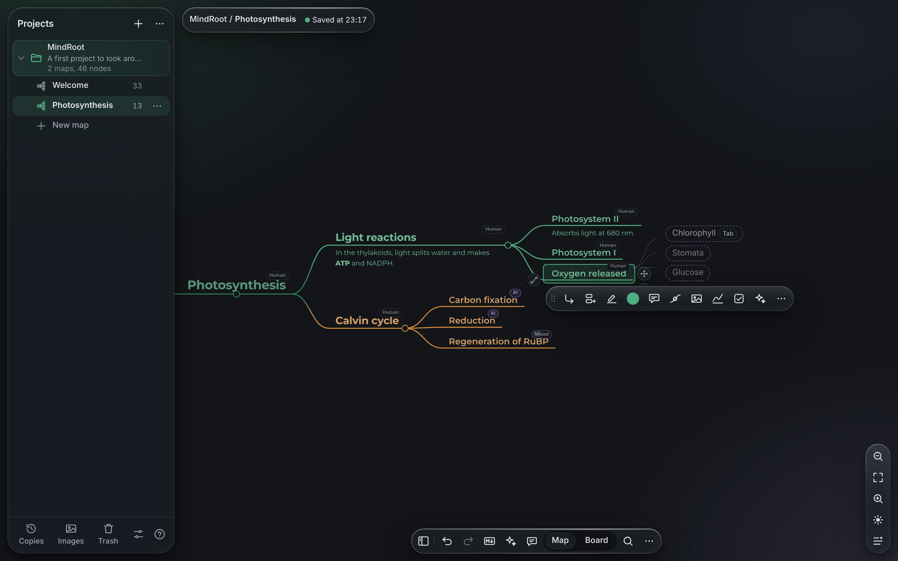
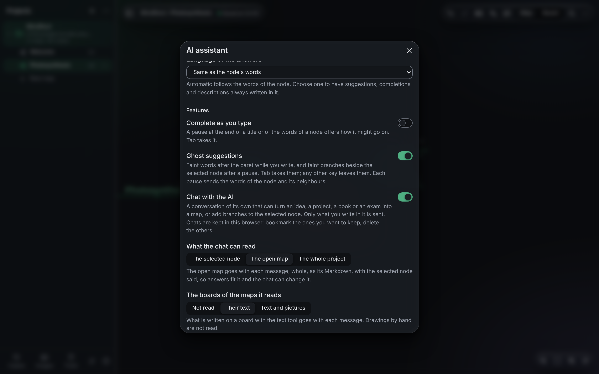
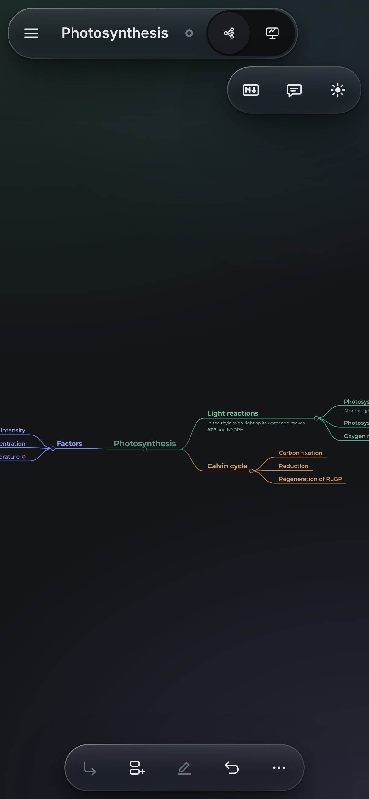

# MindRoot

*Traduzione italiana del [README in inglese](README.md). L'app parla inglese e italiano (Impostazioni > Lingua).*

**Mappe mentali scritte in Markdown semplice, conservate sul tuo dispositivo, che funzionano senza rete.**

Ogni mappa è un file `.md` che puoi leggere e modificare anche in Obsidian, VS Code o qualsiasi editor di testo. MindRoot la disegna come un albero da esplorare, piegare, colorare e riordinare con la tastiera, il mouse o un dito, dà a ogni mappa una lavagna e a ogni nodo un quaderno su cui disegnare e, solo se la attivi, con la tua chiave, un'AI che suggerisce, completa e trasforma i tuoi documenti in mappe.



- **Provalo:** [riccardofioreita.github.io/MindRoot](https://riccardofioreita.github.io/MindRoot/)
- **Il formato dei file:** [docs/FORMAT.md](docs/FORMAT.md)

## Indice

- [L'aspetto](#laspetto)
- [Come aprirlo](#come-aprirlo)
- [Mappe e Markdown](#mappe-e-markdown)
- [Lavagne e quaderni](#lavagne-e-quaderni)
- [Assistente AI (facoltativo)](#assistente-ai-facoltativo)
- [Su telefono o tablet](#su-telefono-o-tablet)
- [I tuoi dati](#i-tuoi-dati)
- [Tastiera](#tastiera)
- [Il Markdown di una mappa](#il-markdown-di-una-mappa)
- [Limiti onesti](#limiti-onesti)
- [Sviluppo](#sviluppo)
- [Crediti e licenze](#crediti-e-licenze)

## L'aspetto

L'interfaccia di MindRoot è disegnata in **vetro liquido**: barre, menu, pannelli e fogli sono vetro trasparente con un bordo speculare e un riflesso morbido, sospesi su una pagina illuminata da una luce ambientale tenue (`css/liquid.css`, token in `css/tokens.css`). La mappa - carta, inchiostro, colori dei rami - non cambia, quindi ciò che ha significato si legge esattamente come prima. Trasparenza ridotta (Impostazioni o sistema), contrasto elevato e colori forzati danno superfici piene.

## Come aprirlo

Niente installazione, niente build, nessun server tuo:

- **Online.** Apri l'indirizzo qui sopra. Dopo la prima visita funziona anche offline (un service worker tiene una copia di ogni file). Le mappe restano solo nel tuo browser.
- **Dalla cartella.** Scarica o clona il repository e fai doppio clic su `index.html`. Funziona nelle versioni recenti di Chrome, Edge, Firefox e Safari, direttamente dal disco.
- **Come file unico.** `node tools/single.js` scrive `dist/MindRoot.html`, con tutto dentro (stili, script, font, icone): portalo su una chiavetta o mandalo come allegato.
- **Come app installata.** Dall'indirizzo online (o da qualsiasi server http locale) il browser propone di installare MindRoot; l'app installata si apre in una finestra sua, funziona offline e apre i file `.md`, `.zip` e `.json` che le passi.

## Mappe e Markdown



- **Un albero che modelli come vuoi.** Aggiungi, rinomina, sposta, piega e colora i nodi; i rami crescono ai due lati del nodo centrale, e qualsiasi nodo si trascina dove vuoi restando attaccato al suo genitore. Riordina rimette tutto a posto in un passo.
- **Testo sotto un nodo** (con elenchi puntati, numerati e da spuntare), note sul nodo e sulla sua linea, caselle da spuntare, link al web e ad altre mappe (`[[Un'altra mappa]]`), menzioni di qualsiasi nodo del progetto (`@`), immagini e disegni.
- **Il pannello Markdown** (Ctrl+M) mostra la stessa mappa come testo; i due restano allineati mentre scrivi, e una modifica riscrive solo le righe che la riguardano.
- **I progetti** raggruppano le mappe, ognuno con le sue immagini, il suo cestino e le sue copie a orario. Ctrl+K trova qualsiasi comando, posto o nodo di qualsiasi mappa.
- **Una mappa per argomento.** Quando una mappa cresce in più argomenti, "Trasforma il ramo in una mappa" (menu del nodo) o "Dividi i rami in mappe" (menu del nodo centrale) sposta i rami in mappe a sé nel progetto: ogni ramo resta come `[[link]]` che apre la sua mappa, il nodo centrale della nuova mappa ha una nota con il link di ritorno, e un solo Annulla riporta tutto com'era. La chat AI può creare una proposta direttamente "Come mappe separate".
- **I link nelle note funzionano.** Un `[[mappa]]` o un indirizzo web scritto in una nota si apre dalla nota stessa (un'etichetta sotto il testo) e dai link del nodo.
- **Esporta** una mappa come SVG (con il font dentro), PNG (che porta con sé la mappa: rilascialo su MindRoot e torna una mappa), PDF (vettoriale, dalla stampa) o Markdown.
- **Non si perde nulla.** Una sola cronologia di annullamento per tutto, un cestino in ogni progetto (rami, immagini, disegni, note, mappe) e copie di ogni mappa cambiata, fatte a orario o a mano, con le modifiche evidenziate prima di tornare a una di esse.

## Lavagne e quaderni



Ogni mappa ha una **lavagna** (Mappa | Lavagna, Ctrl+Maiusc+L), e ogni nodo può avere il suo **disegno**. Entrambi sono quaderni:

- **Tele infinite** (il default) o **pagine di formato fisso** (da A3 ad A6, B5, Letter, Legal, quadrato, 16:9, 4:3, iPad o qualsiasi misura in mm).
- **30 carte**: puntini, quadretti, righe, rigature scolastiche, appunti Cornell, carta millimetrata, logaritmica e polare, pentagrammi, wireframe, agende, guide di calligrafia, o un'immagine tua.
- **Strumenti**: penna, matita, pennarello, pennello ed evidenziatore sensibili alla pressione, forme, frecce, testo, immagini, selezione e una gomma per parte di un tratto, un tratto intero o un'area. L'inchiostro segue il tema.
- **Puntatore laser anche sulla mappa**: il pulsante con punto e raggi nella capsula dello zoom (o Ctrl+Alt+L) indica la mappa con la stessa scia rossa che svanisce - con il mouse basta muoversi, con il dito si trascina - senza spostare né cambiare nulla. Esc o di nuovo il pulsante lo spegne.
- **Puntatore laser** nei quaderni (solo penna): il pulsante con punto e raggi accanto alla penna, oppure Inchiostro | Laser nelle opzioni della penna. La penna lascia una scia rossa che svanisce entro un secondo - per presentare o indicare durante una chiamata - e non disegna nulla: nessun tratto, nessun salvataggio, nessun passo di annullamento. Qualsiasi altro strumento lo spegne.
- **Pagine e tele** con le miniature per aggiungere, duplicare, riordinare e ripristinare; **esporta** un PDF di tutte le pagine o un PNG di una.

Un quaderno è una cartella del progetto (`assets/<nome>.book/`) con un `book.json` e un SVG per pagina: ogni pagina si legge anche fuori da MindRoot e porta dentro il suo disegno modificabile.

## Assistente AI (facoltativo)



Spento, e senza rete, finché non apri le scintille nella barra in alto (Ctrl+Maiusc+A), dai la tua chiave (Anthropic, OpenAI o un indirizzo compatibile con OpenAI, anche un modello sul tuo computer) e attivi una funzione. Poi, solo quando la usi:

- **Chatta con l'AI** (Ctrl+Maiusc+H, o il pulsante della chat nella barra in alto): una conversazione a parte che trasforma un'idea, un progetto, un libro, un esame, o i **documenti che alleghi** (testo, Markdown, CSV, JSON, HTML, Word, e PDF con Anthropic o OpenAI), in rami, in una nuova mappa o in un **intero progetto ben documentato**, creato con un clic. Può leggere la mappa aperta, tutto il progetto o altri progetti che spunti, taggare mappe e nodi con `@`, vedere immagini e il testo delle lavagne, e proporre modifiche a una mappa che vedi prima di applicarle (un solo annulla). I messaggi si possono modificare e le risposte rigenerare, e ogni versione resta come ramo; le chat si mettono tra i segnalibri, si esportano, si importano ed entrano nel backup completo.
- **Suggerimenti in trasparenza**: parole tenui dopo il cursore mentre scrivi, e rami tenui accanto al nodo selezionato; Tab li accetta. **Completa mentre scrivi** propone lo stesso in un riquadro.
- **Suggerisci rami**, **Suggerisci un'icona**, **Descrivi le immagini** e, con OpenAI, **Illustra con immagini**.
- **Chi ha scritto ogni nodo**: una piccola etichetta, AI, Misto o Umano, su ogni nodo (attiva di serie, non invia nulla). Quello che ha fatto l'AI porta un segno nascosto nel Markdown (`<!-- by: ai -->`), che diventa `mixed` quando ci scrivi dentro.



**Con un'altra AI**: «Copia la guida per un'altra AI» nella finestra AI dà a qualsiasi assistente in chat il formato di un progetto MindRoot; scrive un file JSON, che MindRoot importa così com'è.

Cosa si invia lo dice la finestra AI: di serie solo le parole del nodo e dei nodi intorno; la chat invia quello che ci scrivi, e la mappa aperta, il progetto o altri progetti solo se lo permetti. La chiave sta in questa scheda, in questo browser o cifrata da una password, mai in una mappa o in un backup. **L'uso dell'AI consuma token sul tuo account presso il servizio, e i costi potrebbero essere alti: verificali con il tuo servizio.**



## Su telefono o tablet



Pannelli dal basso e una barra per il pollice, invece di un desktop rimpicciolito:

- un tocco seleziona un nodo, un doppio tocco lo rinomina, una pressione lunga apre il suo menu (continua a muovere il dito per trascinarlo);
- un dito sposta la mappa, due dita fanno zoom; un trascinamento dal bordo sinistro mostra i progetti;
- la barra in basso ha figlio, fratello, rinomina e annulla, e «Altro» per il resto; una piccola capsula in alto a destra apre con un tocco il Markdown, la chat AI e il laser;
- in un quaderno un dito disegna finché non hai usato una penna, e da lì in poi sposta.

## I tuoi dati

Le mappe stanno nel browser, in un database IndexedDB chiamato `mindroot2`; le preferenze in `localStorage`, sotto chiavi che iniziano con `mindroot2:`. MindRoot salva da solo poco dopo ogni modifica (Ctrl+S salva subito), e la barra in alto dice sempre se l'ultimo salvataggio è riuscito.

I dati appartengono a un browser su un dispositivo, e all'indirizzo da cui hai aperto MindRoot: la versione online, un server locale e una copia aperta da file hanno ognuno uno spazio suo (in Chrome ed Edge tutte le pagine aperte da file ne condividono uno). Cancellare i dati del sito cancella anche le mappe.

Perché non si perda nulla:

- **Backup completo.** Impostazioni (Ctrl+,), «Fai il backup di tutto»: uno ZIP con una cartella `.interneuron` per progetto (ogni mappa dentro è un `.md` leggibile senza MindRoot) e le chat AI. «Ripristina un backup» lo rimette accanto a quello che c'è, senza sovrascrivere nulla. È anche il modo di spostare le mappe tra browser e dispositivi. Dopo una settimana senza backup, un avviso discreto te lo ricorda.
- **Un progetto alla volta.** Il menu del progetto lo esporta come ZIP o JSON. Importa con Ctrl+O, o rilascia sulla pagina uno ZIP, un JSON, un `.md` o un PNG esportato da MindRoot.
- **Memoria persistente.** Servito via http(s), MindRoot chiede al browser di non cancellare i suoi dati quando il disco si riempie.

## Tastiera

Su Mac, Ctrl vuol dire ⌘. L'elenco completo è nell'aiuto (F1 o `?`), generato dai comandi dell'app stessa.

| Tasto | Cosa fa |
| --- | --- |
| Tab / Invio / Maiusc+Invio | Aggiunge un figlio, un fratello dopo, un fratello prima |
| F2, doppio clic o qualsiasi lettera | Rinomina (Invio salva il titolo; nel testo sotto Invio va a capo, Ctrl+Invio salva) |
| Canc | Manda il ramo nel cestino |
| Frecce / Alt+frecce | Si muove tra i nodi / sposta il nodo |
| Spazio | Piega o apre il ramo |
| Ctrl+Z / Ctrl+Maiusc+Z | Annulla e ripeti |
| Ctrl+K / Ctrl+F | La palette / cerca nei nodi |
| Ctrl+M | Il pannello Markdown |
| Ctrl+Maiusc+L | Mappa o lavagna |
| Ctrl+Maiusc+A / Ctrl+Maiusc+H | La finestra dell'assistente AI / la chat AI |
| Ctrl+Alt+L | Il puntatore laser sulla mappa |
| Ctrl+. | Suggerisci rami (AI) |
| Ctrl+Maiusc+E / Ctrl+O | Esporta / importa |
| Ctrl+S / Ctrl+, | Salva ora / impostazioni |

In un quaderno: P penna, E gomma, V selezione, H sposta, R rettangolo, O ellisse, D rombo, L linea, A freccia, T testo.

## Il Markdown di una mappa

```markdown
# La radice della mappa

## Un ramo (un titolo)
- Un nodo (una voce di elenco); rientra di due spazi per un figlio
  - > text: parole sotto il nodo, disegnate sulla mappa
    > - una voce puntata
  - > note: una nota sul nodo
- [ ] Una casella da spuntare
- **grassetto**, *corsivo*, ==evidenziato==, `codice`, [un link](https://example.org), [[Un'altra mappa]]
-  Un nodo con un'immagine
- Un nodo con un colore suo <!-- color: #c2703d -->
- Un nodo scritto dall'AI <!-- by: ai -->

## Un ramo a sinistra della radice <!-- side: left -->
```

I nodi sono titoli e voci di elenco; i segni sono commenti HTML a fine riga, che ogni lettore Markdown nasconde. La specifica completa, con ogni segno, note, immagini, la lavagna, la cartella del progetto, i quaderni, gli export JSON e ZIP e il PNG che porta una mappa, è in **[docs/FORMAT.md](docs/FORMAT.md)** (in inglese).

## Limiti onesti

- Niente si sincronizza tra dispositivi o browser: i dati si spostano con backup ed export.
- Un browser che cancella i dati alla chiusura perde le mappe.
- I test automatici girano solo in Chromium; Firefox e Safari (16.4+) sono previsti dal codice ma non verificati a ogni modifica.
- Le mappe oltre i 5.000 nodi circa si dispongono lentamente mentre scrivi.
- I file PDF non si possono ancora usare come carta di un quaderno.

## Sviluppo

Nessuna dipendenza a runtime e nessuna build: script classici (`window.MindRoot`), niente moduli ES, niente `fetch` di file locali, così gli stessi file funzionano da `file://`, da un server e installati. Il contratto tra i moduli è [`docs/ARCHITECTURE.md`](docs/ARCHITECTURE.md), i formati dei dati [`docs/FORMAT.md`](docs/FORMAT.md), i quaderni [`docs/NOTEBOOK.md`](docs/NOTEBOOK.md) (in inglese).

- `node test/run.js` esegue tutte le suite in Chromium headless (Playwright: `npm i -g playwright`); `node test/run.js <suite> ...` ne esegue alcune, `--list` le elenca. Qualsiasi richiesta di rete, errore di pagina o errore in console fa fallire una suite.
- `node tools/static-audit.js` controlla che la pagina non usi moduli, `fetch`, socket o risorse remote; `node tools/english-audit.js` che il progetto sia scritto in inglese fuori dai dizionari italiani.
- `node tools/single.js` costruisce `dist/MindRoot.html`; `node tools/pages.js <dir>` scrive la cartella della versione online (pubblicata su GitHub Pages da `.github/workflows/pages.yml`).
- `node tools/screens.js` fa gli screenshot di questo README dall'app vera (tema scuro, con l'AI simulata).

## Crediti e licenze

MindRoot è rilasciato con licenza MIT (vedi [`LICENSE`](LICENSE)). Scritto insieme a [Claude](https://claude.ai) (Anthropic).

Il parser Markdown e il modello ad albero, il layout ad albero ordinato con la vista della mappa e l'editor di disegno sono scritti da zero per questa app, ispirati da [markmap](https://github.com/markmap/markmap), [d3](https://d3js.org) ed [Excalidraw](https://github.com/excalidraw/excalidraw); nessun loro codice è incluso. MindRoot legge i commenti `<!-- markmap: fold -->` di markmap e apre i disegni `.excalidraw.svg` di Excalidraw.

Cosa contiene MindRoot:

- Il tratto a mano libera reimplementa l'algoritmo di [perfect-freehand](https://github.com/steveruiz/perfect-freehand) di Steve Ruiz (MIT), in `js/features/ink.js`.
- [Montserrat](https://github.com/JulietaUla/Montserrat) di Julieta Ulanovsky e altri, SIL Open Font License 1.1: `css/fonts/` e, per gli export, `vendor/montserrat-font.js`.
- liquid-glass, un porting senza framework di [rdev/liquid-glass-react](https://github.com/rdev/liquid-glass-react) di Max Rovensky (MIT), in `vendor/liquid-glass.iife.js` con la sua licenza accanto: una decorazione facoltativa, caricata solo in un browser Chromium con il mouse e senza movimento ridotto, trasparenza ridotta o alto contrasto.
