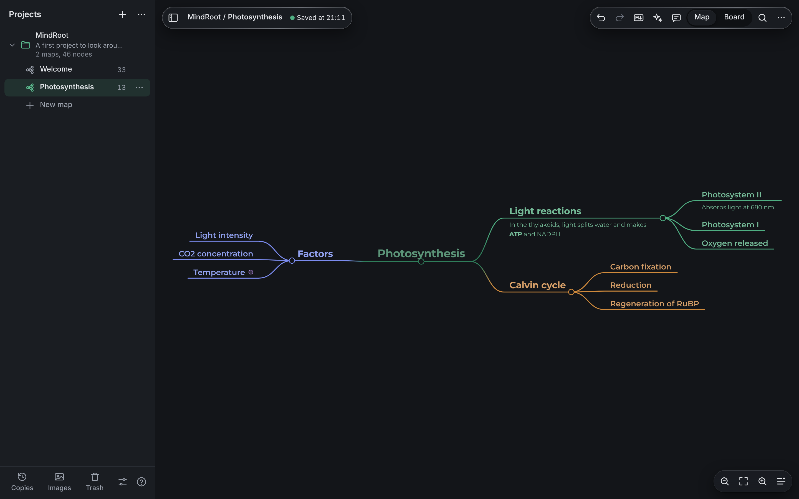
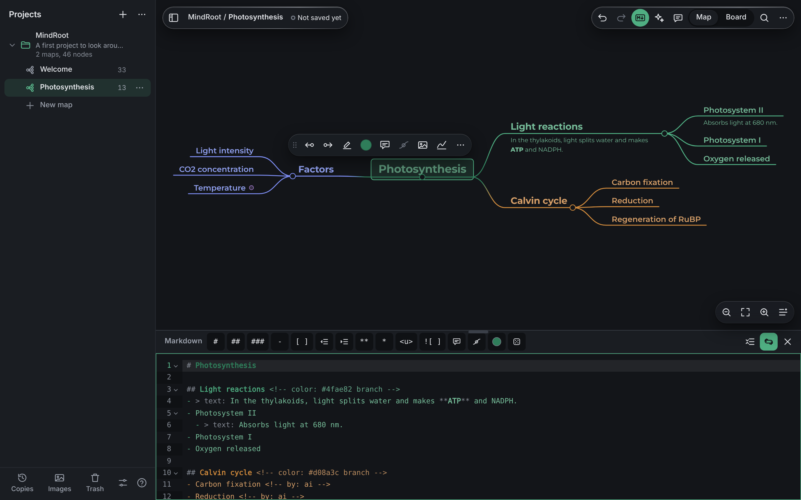
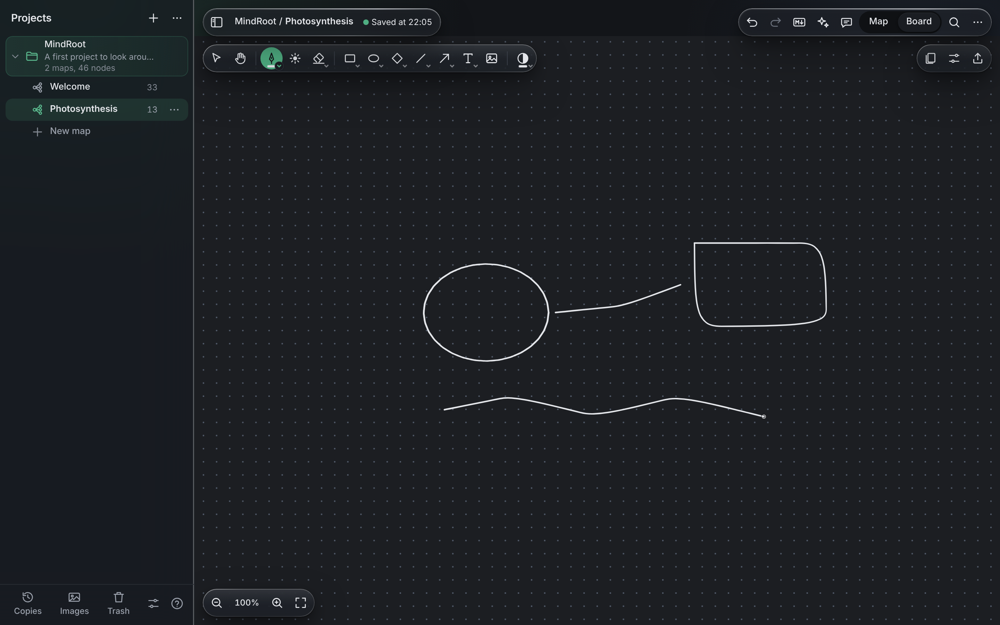
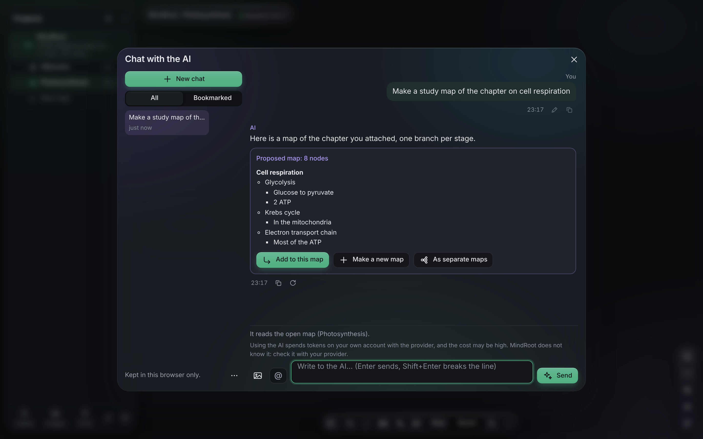
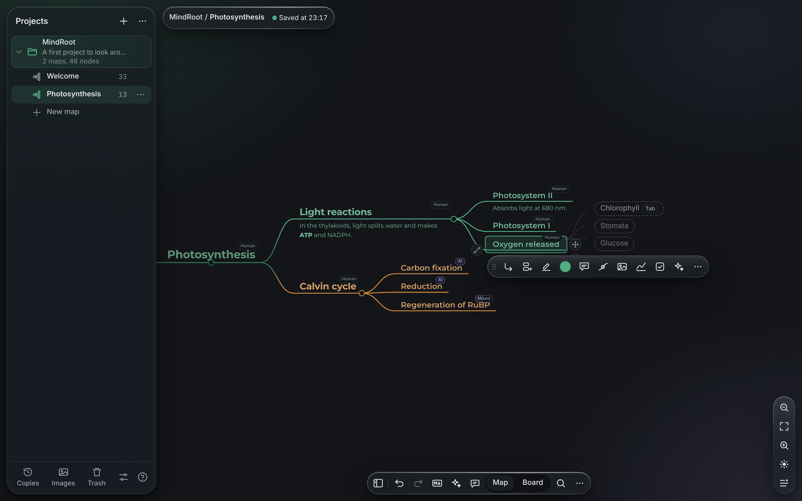
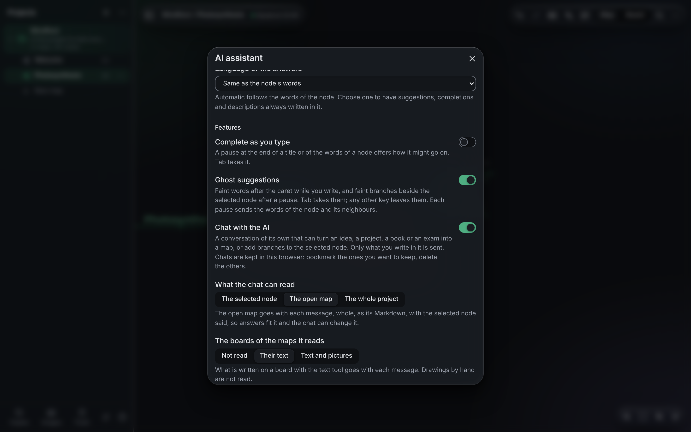
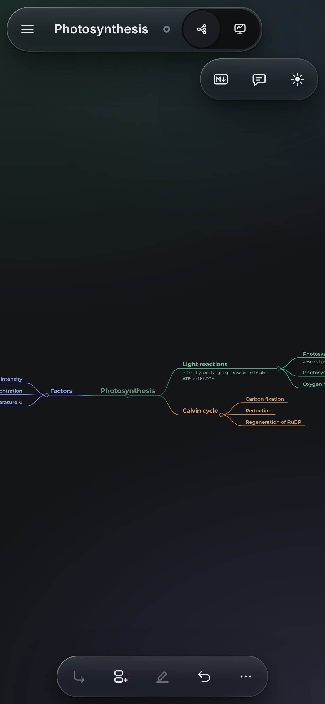

# MindRoot

*An Italian translation of this README is in [README.it.md](README.it.md). The app itself speaks English and Italian (Settings > Language).*

**Mind maps written in plain Markdown, kept on your own device, working with no network.**

Every map is a `.md` file you can also read and edit in Obsidian, VS Code or any text editor. MindRoot draws it as a tree you can explore, fold, colour and rearrange with the keyboard, a mouse or a finger, gives each map a board and each node a notebook to draw in, and - only if you switch it on, with your own key - an AI that suggests, completes and turns your documents into maps.



- **Try it:** [riccardofioreita.github.io/MindRoot](https://riccardofioreita.github.io/MindRoot/)
- **The file format:** [docs/FORMAT.md](docs/FORMAT.md)

## Contents

- [The look](#the-look)
- [Opening it](#opening-it)
- [Maps and Markdown](#maps-and-markdown)
- [Boards and notebooks](#boards-and-notebooks)
- [AI assistance (optional)](#ai-assistance-optional)
- [On a phone or a tablet](#on-a-phone-or-a-tablet)
- [Your data](#your-data)
- [Keyboard](#keyboard)
- [The Markdown of a map](#the-markdown-of-a-map)
- [Honest limits](#honest-limits)
- [Development](#development)
- [Credits and licences](#credits-and-licences)

## The look

**One dock, the map in the middle.** The map's name floats alone at the top left; every action - projects, undo and redo, Markdown, the AI, the chat, search, Map | Board and More - lives in one glass dock at the foot of the map; zoom, fit, the laser and tidy stand upright at the right edge; the projects open as a floating glass panel. On a phone the dock is the thumb bar, with Markdown, AI chat and laser one tap away at the top right.

MindRoot's interface is drawn in **liquid glass**: the bars, menus, panels and sheets are clear glass with a specular rim and a soft sheen, floating over a page lit by faint ambient light (`css/liquid.css`, tokens in `css/tokens.css`). The map itself - paper, ink, branch colours - is untouched, so what carries meaning reads exactly as before. Reduce transparency (Settings, or the system's), more contrast and forced colours give solid surfaces.

## Opening it

No install step, no build, no server of your own:

- **Online.** Open the address above. After the first visit it also works offline (a service worker keeps a copy of every file). Your maps still live only in your browser.
- **From the folder.** Download or clone the repository and double-click `index.html`. It works in recent Chrome, Edge, Firefox and Safari, straight from the disk.
- **As one file.** `node tools/single.js` writes `dist/MindRoot.html`, with everything inside (styles, scripts, fonts, icons): carry it on a USB stick or send it as an attachment.
- **As an installed app.** From the online address (or any local http server), the browser offers to install MindRoot; the installed app opens in its own window, works offline, and opens `.md`, `.zip` and `.json` files handed to it.

## Maps and Markdown



- **A tree you shape freely.** Add, rename, move, fold and colour nodes; branches grow on either side of the central node, and any node can be dragged anywhere while it stays attached to its parent. Tidy puts everything back in order in one step.
- **Words under a node** (with bulleted, numbered and to-do lists), notes on the node and on its line, boxes to tick, links to the web and to other maps (`[[Another map]]`), mentions of any node of the project (`@`), pictures (PNG, JPEG, WebP, SVG and animated GIF, which keeps moving on the map, on boards and in an SVG export; PNG and PDF exports show its first frame) and drawings.
- **The Markdown panel** (Ctrl+M) shows the same map as text; both stay in step as you type, and an edit rewrites only the lines it is about.
- **Projects** group maps, each with its own pictures, trash and timed copies. Ctrl+K finds any command, place or node of any map.
- **One map per topic.** When a map grows into several topics, "Turn the branch into a map" (node menu) or "Split the branches into maps" (central node's menu) moves branches into maps of their own in the project: each branch stays behind as a `[[link]]` that opens its map, the new map's central node carries a note that links back, and one Undo takes it all back. The AI chat can make a proposal straight away "As separate maps".
- **Links in notes work.** A `[[map]]` or a web address written in a note opens from the note itself (a chip under it) and from the node's links.
- **Export** a map as SVG (with its font inside), PNG (which carries the map: drop it back on MindRoot and it is a map again), PDF (vector, through the print dialog) or Markdown.
- **Nothing is lost.** One undo history for everything, a trash in every project (branches, pictures, drawings, notes, maps), and copies of every changed map taken by the clock or by hand, with the changes marked before you go back to one.

## Boards and notebooks



Every map has a **board** (Map | Board, Ctrl+Shift+L), and any node can have its own **drawing**. Both are notebooks:

- **Infinite canvases** (the default) or **fixed-size pages** (A3 to A6, B5, Letter, Legal, square, 16:9, 4:3, iPad or any size in mm).
- **30 papers**: dots, squares, lines, school rulings, Cornell notes, millimetre, log and polar paper, music staves, wireframes, planners, calligraphy guides, or a picture of your own.
- **Tools**: pen, pencil, marker, brush and highlighter with pressure, shapes, arrows, text, pictures, select and an eraser for part of a stroke, a whole stroke or an area. The ink follows the theme.
- **Laser pointer on the map** too: the dot-and-rays button in the zoom capsule (or Ctrl+Alt+L) points at the map with the same fading red trail - a mouse just moves, a finger drags - without moving or changing anything. Escape or the button again turns it off.
- **Laser pointer** in notebooks (pen only): the dot-and-rays button beside the pen, or Ink | Laser in the pen's options. The pen then leaves a red trail that fades within a second - for presenting or pointing during a call - and draws nothing: no stroke, no save, no undo step. Any other tool turns it off.
- **Pages and canvases** with thumbnails to add, duplicate, reorder and restore; **export** as a PDF of every page or a PNG of one.

A notebook is a folder of the project (`assets/<name>.book/`) with a `book.json` and one SVG per page: every page reads outside MindRoot too, and carries its editable drawing inside.

## AI assistance (optional)



Off, and with no network, until you open the sparkles in the top bar (Ctrl+Shift+A), give your own key (Anthropic, OpenAI, or any OpenAI-compatible address, a model on your own computer included) and switch a feature on. Then, only when you use it:

- **Chat with the AI** (Ctrl+Shift+H, or the chat button in the top bar): a conversation of its own that turns an idea, a project, a book, an exam - or the **documents you attach** (text, Markdown, CSV, JSON, HTML, Word, and PDF with Anthropic or OpenAI) - into branches, a new map or a **whole well-documented project**, created with one press. It can read the open map, the whole project, or other projects you tick, tag maps and nodes with `@`, see pictures and the boards' text, and propose changes to a map you see before you apply them (one undo step). Messages can be edited and answers given again, each version kept as a branch; chats can be bookmarked, exported, imported, and go into the full backup.
- **Ghost suggestions**: faint words after the caret while you write, and faint branches beside the selected node; Tab takes them. **Complete as you type** offers the same in a card.
- **Suggest branches**, **Suggest an icon**, **Describe pictures** and, with OpenAI, **Illustrate with pictures**.
- **Who wrote each node**: a small label - AI, Mixed or Human - on every node (on by default, nothing sent). What the AI made carries a hidden marker in the Markdown (`<!-- by: ai -->`), which turns `mixed` when you write into it.



**With another AI**: "Copy the guide for another AI" in the AI window gives any chat assistant the format of a MindRoot project; it writes a JSON file, which MindRoot imports as it is.

What is sent is said in the AI window: by default only the words of the node and the nodes round it; the chat sends what you write in it, and the open map, the project or other projects only if you allow it. The key is kept in this tab, in this browser or encrypted by a passphrase, never in a map or a backup. **Using the AI spends tokens on your own account with the provider, and the cost may be high: check it with your provider.**



## On a phone or a tablet



Bottom sheets and a thumb bar instead of a squeezed desktop:

- a tap selects a node, a double tap renames it, a long press opens its menu (keep moving the finger to drag the node);
- windows such as the AI assistant, settings or help open as sheets from the bottom already at full height; pull the pill down to lower or close them;
- one finger pans, two fingers zoom; a swipe from the left edge brings out the projects;
- the bottom bar holds child, sibling, rename and undo, and "More" for the rest; a small capsule at the top right opens the Markdown, the AI chat and the laser in one tap;
- in a notebook a finger draws until a stylus has been used, and pans from then on.

## Your data

Maps live in the browser, in an IndexedDB database called `mindroot2`; preferences in `localStorage`, under keys starting with `mindroot2:`. MindRoot saves by itself shortly after every change (Ctrl+S saves at once), and the top bar always says whether the last save worked.

The data belongs to one browser on one device, and to the address MindRoot was opened from: the online version, a local server and a copy opened from a file each have a space of their own (in Chrome and Edge, every page opened from a file shares one). Clearing the site's data clears the maps too.

So that nothing is lost:

- **Full backup.** Settings (Ctrl+,), "Back up everything": a ZIP with one `.interneuron` folder per project (every map inside is a `.md` you can read without MindRoot) and the AI chats. "Restore a backup" brings it back next to what is there, overwriting nothing. This is also how maps move between browsers and devices. After a week without a backup, a quiet notice reminds you.
- **One project at a time.** The project's menu exports it as a ZIP or as JSON. Import with Ctrl+O, or drop a ZIP, a JSON, a `.md` or a PNG exported by MindRoot on the page.
- **Persistent storage.** Served over http(s), MindRoot asks the browser not to clear its data when the disk fills up.

## Keyboard

On a Mac, Ctrl means ⌘. The complete list is in the help (F1 or `?`), generated from the app's own commands.

| Key | What it does |
| --- | --- |
| Tab / Enter / Shift+Enter | Adds a child, a sibling after, a sibling before |
| F2, double-click or any letter | Renames (Enter saves the title; in the words under it Enter breaks the line, Ctrl+Enter saves) |
| Delete | Sends the branch to the trash |
| Arrows / Alt+arrows | Move between nodes / move the node |
| Space | Folds or unfolds the branch |
| Ctrl+Z / Ctrl+Shift+Z | Undo and redo |
| Ctrl+K / Ctrl+F | The palette / search the nodes |
| Ctrl+M | The Markdown panel |
| Ctrl+Shift+L | Map or board |
| Ctrl+Shift+A / Ctrl+Shift+H | The AI assistant window / the AI chat |
| Ctrl+Alt+L | The laser pointer on the map |
| Ctrl+. | Suggest branches (AI) |
| Ctrl+Shift+E / Ctrl+O | Export / import |
| Ctrl+S / Ctrl+, | Save now / settings |

In a notebook: P pen, E eraser, V select, H pan, R rectangle, O ellipse, D diamond, L line, A arrow, T text.

## The Markdown of a map

```markdown
# The root of the map

## A branch (a heading)
- A node (a list item); indent by two spaces for a child
  - > text: words under the node, drawn on the map
    > - a bulleted item
  - > note: a note on the node
- [ ] A box to tick
- **bold**, *italic*, ==highlight==, `code`, [a link](https://example.org), [[Another map]]
-  A node with a picture
- A node with a colour of its own <!-- color: #c2703d -->
- A node the AI wrote <!-- by: ai -->

## A branch on the left of the root <!-- side: left -->
```

Nodes are headings and list items; markers are HTML comments at the end of a line, which every Markdown reader hides. The complete specification - every marker, notes, pictures, the board, the project folder, notebooks, the JSON and ZIP exports and the PNG that carries a map - is in **[docs/FORMAT.md](docs/FORMAT.md)**.

## Honest limits

- Nothing syncs between devices or browsers: backups and exports are how data moves.
- A browser that clears its data on exit loses the maps.
- The automated tests run in Chromium only; Firefox and Safari (16.4+) are targeted by the code but not checked at every change.
- Maps of more than about 5,000 nodes lay out slowly while you type.
- PDF files cannot be used as notebook paper yet.

## Development

No runtime dependency and no build: classic scripts (`window.MindRoot`), no ES modules, no `fetch` of local files, so the same files run from `file://`, from a server and installed. The contract between the modules is [`docs/ARCHITECTURE.md`](docs/ARCHITECTURE.md), the data formats [`docs/FORMAT.md`](docs/FORMAT.md), the notebooks [`docs/NOTEBOOK.md`](docs/NOTEBOOK.md).

- `node test/run.js` runs every suite in headless Chromium (Playwright: `npm i -g playwright`); `node test/run.js <suite> ...` runs some, `--list` lists them. Any network request, page error or console error fails a suite.
- `node tools/static-audit.js` checks that the page uses no modules, no `fetch`, no sockets and no remote resources; `node tools/english-audit.js` that the project is written in English outside the Italian dictionaries.
- `node tools/single.js` builds `dist/MindRoot.html`; `node tools/pages.js <dir>` writes the folder of the online version (deployed to GitHub Pages by `.github/workflows/pages.yml`).
- `node tools/screens.js` takes the screenshots of this README from the real app (dark theme, the AI played by a stand-in).

## Credits and licences

MindRoot is released under the MIT licence (see [`LICENSE`](LICENSE)). Co-authored by [Claude](https://claude.ai) (Anthropic).

The Markdown parser and tree model, the tidy-tree layout and map view, and the drawing editor are written from scratch for this app, inspired by [markmap](https://github.com/markmap/markmap), [d3](https://d3js.org) and [Excalidraw](https://github.com/excalidraw/excalidraw); no code from them ships here. MindRoot reads markmap's `<!-- markmap: fold -->` comments and opens Excalidraw's `.excalidraw.svg` drawings.

What MindRoot does contain:

- The freehand stroke reimplements the algorithm of [perfect-freehand](https://github.com/steveruiz/perfect-freehand) by Steve Ruiz (MIT), in `js/features/ink.js`.
- [Montserrat](https://github.com/JulietaUla/Montserrat) by Julieta Ulanovsky and others, SIL Open Font License 1.1: `css/fonts/` and, for exports, `vendor/montserrat-font.js`.
- liquid-glass, a framework-free port of [rdev/liquid-glass-react](https://github.com/rdev/liquid-glass-react) by Max Rovensky (MIT), in `vendor/liquid-glass.iife.js` with its licence beside it: an optional decoration, loaded only in a Chromium browser with a mouse and without reduced motion, reduced transparency or high contrast.
